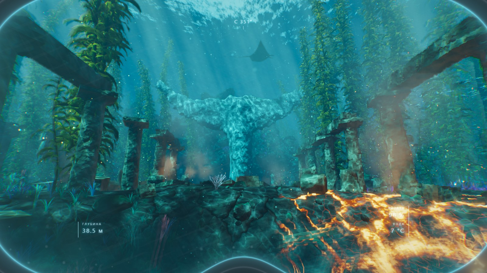
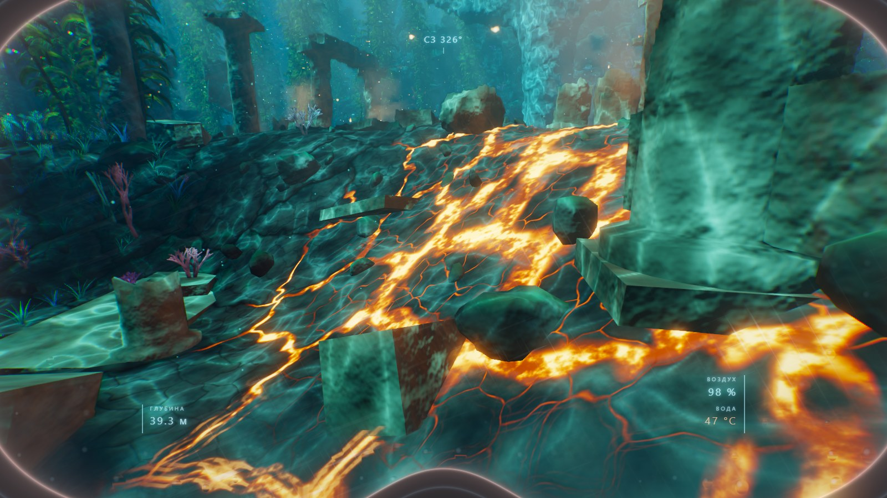
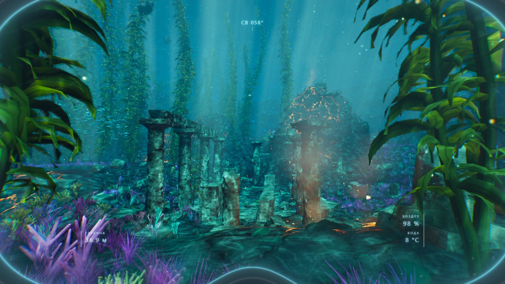
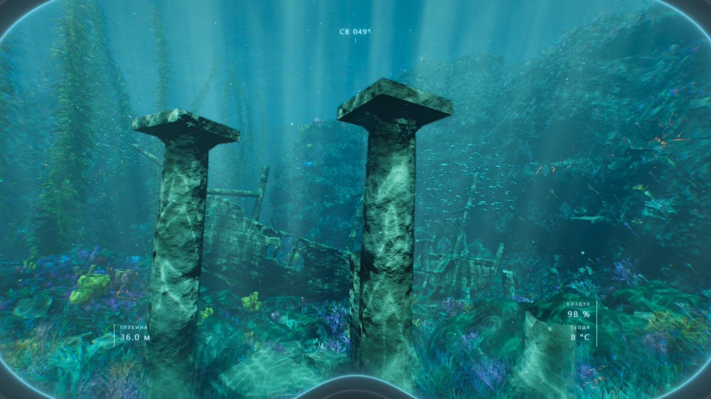
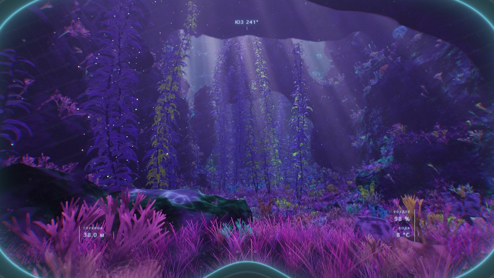

# Glubina (Depth)

An underwater world you can swim through, right in your browser: a volcanic seabed of cracked basalt with lava glowing
in the cracks, the ruins of a drowned ancient city (colonnades, a temple, an arcade), smoke and embers over the fissures,
a kelp forest, light shafts, caustics, a shipwreck, a stone whale tail, manta rays, schools of fish, floating boulders
and a purple grotto — all seen through the visor of a diving helmet.

Everything is procedural: no images, no 3D models, no sound files. Plain WebGPU with no engine or 3D library.
The result is a single self-contained `index.html` (about 120 KB).

The idea and the list of things in the scene come from the description of
[Noniv/abyssal-garden](https://github.com/Noniv/abyssal-garden) (its README and `prompt.txt`).
The code, shaders and page design were written independently; nothing was carried over from that project.

The in-game interface is in Russian.



| | |
|---|---|
|  |  |
|  |  |

## Run

Open `index.html` in Chrome or Edge on a desktop computer. It needs a browser with WebGPU.
No server and no install are needed, and it works offline. You do not need to build anything to run it:
a ready `index.html` is in the repository.

| | |
|---|---|
| Look around | mouse |
| Swim | `W` `A` `S` `D` |
| Up / down | `E` / `Q` |
| Swim faster | `Shift` |
| Jump to a viewpoint | `1` – `6` |
| Helmet off / instruments off | `V` / `G` |
| Sound / frame counter / menu | `M` / `H` / `Esc` |

On a touchscreen: hold a finger down to swim forward, slide it to steer, put a second finger down to go faster.
The detail level (low / medium / high) is chosen in the menu. If the frame rate is too low, the render resolution drops by itself.

## Build

You only need to build after changing something in `src/` or `template.html`.

**What you need**

- [Node.js](https://nodejs.org) 18 or newer (it comes with `npm`).
- Internet access for the first `npm install`. It downloads one build tool, [esbuild](https://esbuild.github.io), and
  `puppeteer-core` for the optional screenshot tools.

**Steps**

```bash
git clone https://github.com/Keshoid/ocean.git
cd ocean
npm install
npm run build
```

`npm run build` bundles everything in `src/` into `template.html` and writes a minified `index.html` in the project root.
Open that file in the browser to see the result.

```bash
node build.mjs --dev   # same, but the code stays readable (easier to debug in the browser's developer tools)
```

If `npm install` warns that install scripts were not run for esbuild, or (on Node older than 22) about the engine
required by `puppeteer-core`, the build still works.

## The view from the helmet

You look out through the visor of a fantasy diving suit: a dark rim with a thin glowing seam (it turns red near lava),
a slight squeeze and colour fringe towards the edges of the glass, scratches that only show against bright light,
condensation at the bottom that mists over as you breathe out, exhaled bubbles streaming past the visor, the sound of
breathing, and the rest of the world muffled by the helmet. The helmet trails a little behind the turn of your head and
the view sways with each stroke. Instruments on the glass show depth, heading, air and water temperature.
The water shimmers over the lava, the lava growls and crackles when you are close, and drifting particles stretch into
streaks at speed.

All of this lives in `fsComp` (`shaders.js`), the "the helmet" block in `main.js`, and `audio.js`.

## What is where

| File | What's inside |
|---|---|
| `src/world.js` | The world layout: rocks, arches, the grotto, lava hot spots, ruins, kelp, corals, sponges, fish, mantas, viewpoints. **Start here.** |
| `src/sdf.js` | The terrain, ship and whale as distance fields (compute shader), surface nets meshing, the 3D noise texture |
| `src/shaders.js` | The whole look: water and fog colours, lighting, lava, caustics, kelp, the surface, light shafts, the visor and post-processing (WGSL) |
| `src/main.js` | The renderer, camera, controls, helmet behaviour, detail levels |
| `src/meshes.js` | Procedural meshes: rocks, corals, sponges, ground cover, manta, fish |
| `src/ruins.js` | Meshes of the ruins: columns, blocks, arches |
| `src/audio.js` | The synthesised soundscape (Web Audio) |
| `template.html` | The page around the scene: menu, instruments, styles |
| `build.mjs` | The build script |

Some easy tweaks:

- **Lava:** hot spots are placed in `world.js` (`addSpot`); the look of the cracks and the glow is the "volcanic seabed"
  block in `fsStatic` and `LAVAC` in `shaders.js`.
- **Ruins:** the "the drowned city" block in `world.js`.
- **Water and sunlight colours:** `WCOL`, `DCOL`, `PCOL` and `SUNC` at the top of `shaders.js`.
- **Brightness, light shafts, bloom, swimming speed:** `EXPOSURE`, `RAYS`, `BLOOM` and `22 : 6.5` in `main.js`.
- **Brightness of the instruments:** `#visor.on { opacity }` in `template.html`.

## Checking it without a person at the keyboard

These tools render the built `index.html` in headless Chrome or Edge with real WebGPU. They are optional and need more
than the build does: Node.js 22.12 or newer, Chrome or Edge installed in its default location on Windows, and a GPU.

```bash
node tools/shot.mjs 1 2 3 4 5 6            # the six viewpoints -> shots/
node tools/shot.mjs cam=0,10,40,0,0.1      # free camera: x,y,z,yaw,pitch
node tools/shot.mjs 1 --w=2560 --h=1440 --perf=1 --map   # frame times and a top-down map of the world
node tools/menu.mjs                        # smoke test of the real page (menu, then a swim)
```

## How it works

- The seabed and rocks are a distance field built from primitives and noise. It is evaluated on the graphics card at load
  time and turned into a mesh (surface nets). The ship and the whale tail are made the same way. The same field stops the
  camera from swimming into rock.
- About 310,000 kelp blades, 75,000 tufts of ground cover and 55,000 rocks, corals, sponges and pieces of ruin are drawn
  with instancing, split into cells with frustum culling and distance-based level of detail.
- Lighting: a 4096² sun shadow map, caustics from a texture regenerated every frame, fog that absorbs each colour at its
  own rate, light shafts (a march through the shadow map at half resolution), glow from the lava fields, bloom, 4× MSAA.
- Kelp, fish, mantas, vent bubbles and particles are animated in vertex shaders; per frame the JavaScript only culls cells,
  updates the diver's own bubbles and issues draw calls.
